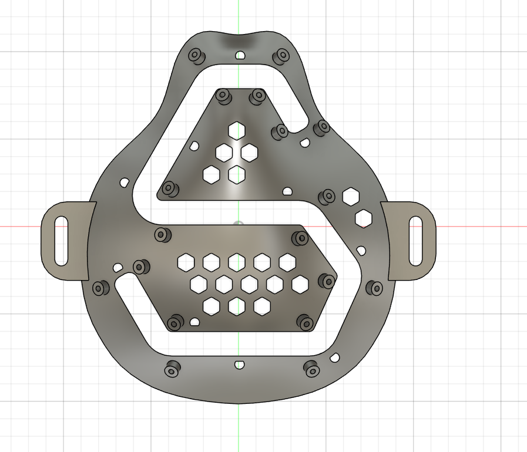

# Mammary Protect

Mammary Protect is an early-stage wearable breast-monitoring research project. This repository shares the mechanical design work, concept images, and the current system architecture for funding and technical review. The Fusion 360 archives are the editable design sources; STEP and mesh files support viewing and fabrication experiments.

The image above is a screenshot from an earlier CAD iteration; inspect the native archive for the latest geometry.

## What is here

| Area | Contents | Status |
| --- | --- | --- |
| [Fusion 360 CAD](cad/fusion/) | Patch, probe holder, and breast holder assembly archives; STEP exports where available | Prototype designs |
| [Meshes](cad/mesh/) | Earlier STL and 3MF patch and enclosure iterations | Historical prototypes |
| [OpenSCAD](cad/openscad/) | Parametric honeycomb patch exploration | Early concept |
| [Images](images/) | CAD iteration screenshots and visual studies of the patch and straps | Visual references, not manufacturing drawings |
| [Electronics](electronics/README.md) | Proposed sensing and processing architecture | Planning stage; no verified schematic or PCB source yet |
| [Design notes](docs/) | CAD inventory, probe dimensions, prototype materials, and project status | Working notes |

The latest exported patch is [almost-final-patch-v16.f3d](cad/fusion/almost-final-patch-v16.f3d). Its associated STEP file is in the same folder. The probe holder is [probe-design-holder-v5.f3d](cad/fusion/probe-design-holder-v5.f3d). See the [CAD inventory](docs/cad-inventory.md) before treating any model as fabrication ready.

## Intended system

The concept combines a wearable breast patch, a mechanically guided ultrasound probe, temperature sensing, acquisition electronics, and software for review of the recorded data. The planned probe holder uses two 3 mm diameter by 5 mm high magnets at 30.5 mm center spacing for docking to paired locations on the patch. This is a design target, not a verified final fit.

The work is at prototype stage. The present files do **not** establish diagnostic accuracy, clinical safety, or regulatory approval. The industrial 5 MHz dual-element probe discussed during exploration is not represented here as a clinically validated imaging transducer. More information is in [project status](docs/project-status.md) and [electronics plan](electronics/README.md).

## Related software

Related public software appears in separate repositories maintained by another account: [Mammary Protect app and backend](https://github.com/kikwasteve23/mammary-protect) and [Mammary Protect application](https://github.com/kikwasteve23/Mammary_Protect_Application). Those repositories are linked for context and are not mirrored here. Their relationship to this design, implementation status, and rights should be confirmed with the maintainers.

## Reuse and provenance

Files in this repository are shared for review. No open-source license has been granted. The images marked as concepts are illustrative. Third-party product photos, papers, installers, personal records, and grant application documents are deliberately excluded.
