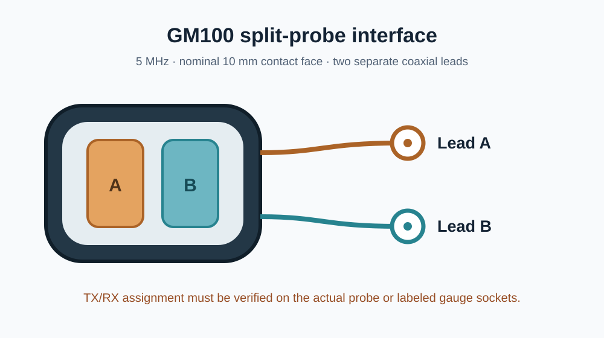

# GM100 probe reference

The user-supplied product photos show an angled `5P Ø10` probe head and a cable splitting into two coaxial leads. A [GM100 instruction manual](https://pdt.static.globalsources.com/IMAGES/PDT/SPEC/784/K1154706784.pdf) identifies separate transmit and receive sockets on the thickness gauge and specifies a standard 5 MHz, nominal 10 mm probe. The catalog describes a 1.2–300 mm measurement range **in steel**; that range does not describe performance in tissue. [GM100 product catalog](https://www.itysp.com/wp-content/uploads/2019/03/2018GM-E-catalogue.pdf)

The [KiCad probe-interface schematic](../electronics/kicad/probe-interface.kicad_sch) records two independent coaxial signal paths as lead A and lead B. The seller photograph does not reveal which physical connector is TX and which is RX. The connector family and mating part number are also unverified. No footprint is assigned to the generic coax symbols.

## Electrical data still needed

The available manual does not state the probe elements' impedance or capacitance, transmit voltage limits, receive sensitivity, shield arrangement, or acoustic output. The actual probe and labeled GM100 gauge sockets should be checked before attaching it to a new pulser/receiver. This repository does not contain a drive circuit for this probe.

The uploaded product images were used as visual references. The original illustration above is provided instead of republishing the seller photographs.
