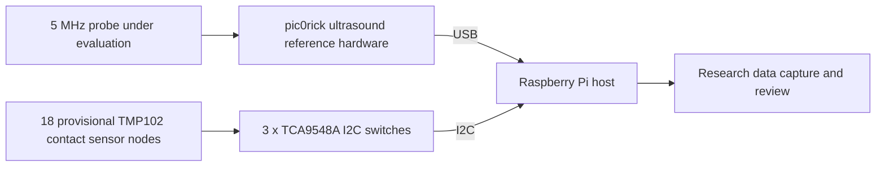

# Electronics

The first editable Mammary Protect schematics are in [kicad/](kicad/). They define a provisional 18-position **contact-temperature** sensing hub and a reusable sensor node. The PDFs can be reviewed without KiCad. Both source schematics passed KiCad 10 electrical rules checks with zero violations on 2026-11-04; this checks schematic connectivity, not component suitability or physical safety.

The ultrasound acquisition hardware is still a separate development track. [pic0rick](https://github.com/kelu124/pic0rick) is the open-hardware **reference** being evaluated for pulsing, echo reception, gain control, digitization, and USB data transfer. Its KiCad schematics and firmware remain in its original repository under the maintainer's license. No pic0rick board has been copied or represented as an original Mammary Protect design here.

The candidate industrial 5 MHz dual-element probe, the pulse/receive interface to it, power isolation, cable protection, and measurement quality remain unverified. The KiCad files are research-prototype schematics, not a clinical or fabrication release. See the [KiCad design notes](kicad/README.md).
