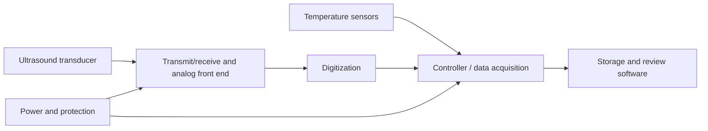

# Electronics architecture (proposed)

No verified Mammary Protect circuit schematic, PCB layout, or fabrication files were found in the local project folders inspected for this release. This page records the intended blocks; it is **not** a working circuit.

The exploratory probe discussed in project notes was a single 5 MHz dual-element industrial probe. A single mechanically moved probe would not require an array multiplexer, but imaging performance and transducer suitability remain unresolved. The exact pulse/receive circuit, analog gain, sampling rate, power architecture, and sensor selection have not been finalized.

External ultrasound projects discussed in research chats were references, not original Mammary Protect circuit designs. No external schematic is reproduced here.
